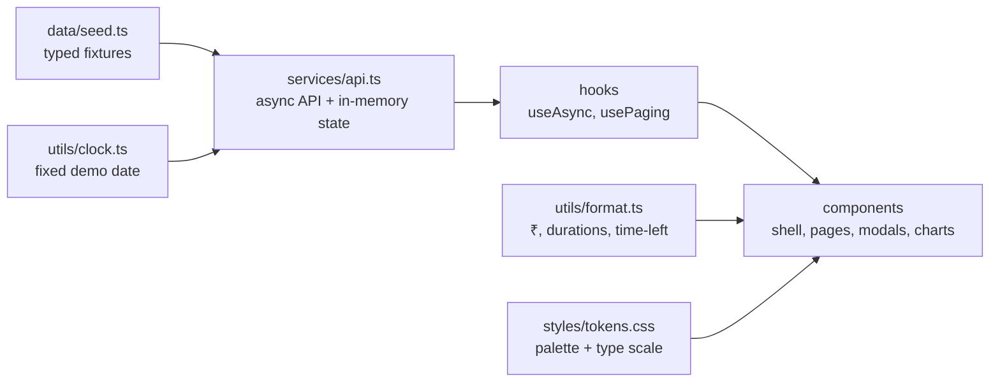

<div align="center">

# On-Ground.ai Call Centre App

**A front-end rebuild of the call-centre agent workspace: dashboard, calling plan, calendar, team chat and lead intelligence, all running on sample data.**

[](https://oga-callcentre-app.vercel.app)


</div>

---

## Contents

1. [Overview](#overview)
2. [Live demo](#live-demo)
3. [Feature walkthrough](#feature-walkthrough)
4. [Tech stack and why](#tech-stack-and-why)
5. [Architecture](#architecture)
6. [Project structure](#project-structure)
7. [Running it locally](#running-it-locally)
8. [Testing and quality](#testing-and-quality)
9. [Design decisions](#design-decisions)
10. [What is built, and what is not](#what-is-built-and-what-is-not)
11. [Placeholders and invented content](#placeholders-and-invented-content)
12. [How I worked](#how-i-worked)
13. [AI tools used](#ai-tools-used)
14. [Reference mock statement](#reference-mock-statement)
15. [Known issues](#known-issues)

---

## Overview

This project is my submission for the On-Ground.ai engineering assignment. The brief was to rebuild the Call Centre staff app, the screen an agent keeps open through a shift, so that it matches the supplied reference visually, behaves correctly, and is cleanly engineered.

The app is a single-page React application with **no backend**. Everything the agent sees (KPIs, planned calls, missed calls, calendar events, chat channels, leads and buying signals) comes from typed sample data served through a small asynchronous service layer. That layer behaves like a real API, with loading states, derived values and in-memory writes, so the UI code is written the way it would be against a real backend.

I focused on three things: getting the required screens to feel faithful to the reference, making the interactions genuinely work (paging, expanding, sending, answering, calling), and keeping the code simple enough that I can explain every part of it.

## Live demo

**https://oga-callcentre-app.vercel.app**

Suggested path through the app:

1. **Dashboard**: check the KPI cards, hover a chart bar, then click **2 hot leads** to open the Leads modal and page through it with the arrow buttons or the keyboard.
2. **Plan, Calls to make**: expand a lead, then move through the three pages.
3. **Plan, Incoming**: press **Call back** on any row. The Call back control is always visible, never hover-only.
4. **Plan, Recent**: open a call to see the SOP review. Ritu S. has a full checklist.
5. **Pulse**: open `#callcentre-team`, answer the pinned **Needs your input** card, send a message, then go back to the Dashboard and notice that your **My Tasks** list has changed.
6. **Pulse, Daily Brief**: use the AvaniBot card to get a daily brief.

## Feature walkthrough

### App shell
A persistent dark-green sidebar and top bar wrap every screen. The sidebar groups the four Plan views under **Plan**, highlights only the current route and marks it with `aria-current`. The top bar shows the agent's score ring, rank, notification bell and avatar, all loaded from the service layer rather than hard-coded. Below the `md` breakpoint the sidebar becomes a slide-in drawer with a backdrop, an Escape-key handler, scroll lock and focus management, and every screen stacks to a single column without horizontal overflow (verified at 360px, 390px and 768px).

### Dashboard
- Greeting hero with the four headline KPIs and delta chips.
- "My progress today" panel, "Who's waiting" list with a link into the planner.
- Monthly earnings card with a slab progress bar computed from the data.
- **My Tasks** card whose rows are *derived* from the open pinned cards in Pulse.
- Two seven-day Recharts bar charts (calls handled and CSAT), with the "Today" bar emphasised and tooltips showing the real values.

### Plan
- **Calls to make**: leads ranked by score, two per page with a pager, an accordion row that reveals the story so far, preferred product, cross-sell and financing note, and a **Place call** action.
- **Incoming**: missed calls ranked by expected value. The count and the total value at stake are computed from the rows. Unknown callers are handled as "New contact". **Call back** moves through a calling state with a timer and an end-call step.
- **Recent**: a compact call history. Opening a call shows an SOP review panel with a computed adherence percentage and a pass/fail checklist.
- **Practise a call**: scripted scenarios played in a modal call screen. Completing one pays a reward that shows up in the Dashboard earnings.

### Calendar
A month grid for October 2026 with previous and next month controls, a **Today** button that always returns to the demo date, event dots under days with events, a selected-day panel and an **Upcoming** list.

### Pulse
- **Home**: search, AvaniBot card, collapsible Custom Agents (role and task agents with health percentages), a General section, a Kudos banner, channels and direct messages.
- **Channel chat**: purple header with back button, pinned **Needs your input** card, grouped message bubbles (others left, you right), and a composer that sends on Enter.
- **AvaniBot chat**: two pinned cards, a daily brief generated after a short delay, and a graceful fallback reply for anything else.

### Leads modal
Opened from the Dashboard task list. It pages through the hot leads with next, previous, a dot indicator and the arrow keys. Each lead shows ICP score and lead-intent score as separate metrics, a time-left chip, collapsible ICP breakdown and history, buying signals with evidence quotes, and the cumulative-missed footer. It closes with the close button, Esc or a backdrop click, and the Dashboard underneath keeps its state.

## Tech stack and why

| Technology | Role | Why I chose it |
| --- | --- | --- |
| **React 18** | UI | Preferred in the brief, and component composition suits a dense, repeated-card interface. |
| **TypeScript (strict)** | Language | The data model is the backbone of this app. Strict types make it visible and catch mistakes early. |
| **Vite** | Tooling | Fast dev server and a small, simple production build. |
| **Tailwind CSS + CSS variables** | Styling | A restrained fixed type scale and a single palette defined once as tokens, which keeps spacing and colour consistent across screens. |
| **React Router** | Routing | Real URLs for every screen, and the browser back button works naturally in Pulse. |
| **Recharts** | Charts | Declarative bar charts with tooltips, and it keeps chart code short. |
| **Vitest + Testing Library** | Tests | Same toolchain as Vite, fast, and good for testing hooks, services and components. |
| **lucide-react** | Icons | One consistent line-icon family that is close to the reference. |

I deliberately did not add a state-management library. The app has little cross-screen state, and what it has lives in the service layer.

## Architecture



The rule I held to throughout: **components never import fixtures**. They ask the service layer, which returns promises, so every screen has real loading, empty and error states.

Everything derived is computed in the service layer, not in JSX:

- call ranking and paging
- missed-call count, total value at stake and ordering
- SOP adherence percentage from the checklist
- the Dashboard task list, derived from which pinned cards are still open
- earnings after a completed practice call

## Project structure

```text
src/
  app/            router, app context
  components/
    shell/        Sidebar, TopBar, AppShell
    ui/           Card, Badge, Button, Avatar, ProgressBar, Modal
    dashboard/    greeting hero, KPI cards, progress, waiting list, earnings, tasks, charts
    plan/         planner header, calls to make, incoming, recent, review panel, practise
    calendar/     month grid, header, selected-day panel, upcoming list
    pulse/        home, channel list, channel chat, pinned cards, composer
    leads/        hot leads modal and lead card
  data/           types.ts and seed.ts (single source of fixtures)
  services/       api.ts (async API boundary, derived values, in-memory writes)
  hooks/          useAsync, usePaging
  styles/         tokens.css (palette, type scale, radii, shadows)
  utils/          clock.ts, format.ts, calendar.ts
  test/           test setup
```

Routes:

| Route | Screen |
| --- | --- |
| `/dashboard` | Dashboard |
| `/plan/calls` | Plan, Calls to make (`/plan` redirects here) |
| `/plan/incoming` | Plan, Incoming |
| `/plan/recent` | Plan, Recent |
| `/plan/practise` | Plan, Practise a call |
| `/calendar` | Calendar |
| `/pulse` | Pulse home |
| `/pulse/:channelId` | Channel chat, including `avanibot` |

Pages are lazy-loaded per route, which keeps the initial bundle small and lets Recharts load only when the Dashboard is opened.

## Running it locally

**Requirements:** Node.js 18 or newer.

```bash
git clone https://github.com/Sivaani-Janaswamy/oga-callcentre-app.git
cd oga-callcentre-app
npm install
npm run dev
```

Then open the URL that Vite prints (normally `http://localhost:5173`).

| Script | What it does |
| --- | --- |
| `npm run dev` | Start the development server |
| `npm run build` | Type-check and create a production build |
| `npm run preview` | Serve the production build locally |
| `npm run lint` | Run ESLint (zero warnings expected) |
| `npm test` | Run the Vitest suite |
| `npm run format` | Format the codebase with Prettier |

The repository includes a `vercel.json` that rewrites all routes to `index.html`, so deep links and refreshes work on the hosted site.

## Testing and quality

The test suite focuses on logic that is easy to get wrong rather than on snapshots:

- formatting helpers (rupees, durations, time-left) and the demo clock
- the paging hook (first page, last page, empty list)
- the calendar month-grid builder (week offsets and month lengths)
- the Dashboard KPI cards rendering values that come from the service
- SOP adherence being computed from the checklist, not stored
- answering a pinned card removing the matching Dashboard task
- completing a practice call increasing earnings

Beyond tests, the codebase follows these rules:

- TypeScript strict mode, with no `any` and no ESLint suppressions.
- `new Date()` is only used in `clock.ts`, so the app has exactly one idea of "today".
- No hard-coded data inside components.
- Colours and sizes come from tokens, not literals.
- A global `:focus-visible` ring so every control is keyboard-usable, and the modal traps and restores focus.

Verification results on the production preview:

- Lighthouse accessibility scores **1.0** on Dashboard, Calls to make, Pulse and Calendar.
- An automated browser audit found no horizontal overflow at 360px, 390px or 768px on any screen, and exercised the drawer, the Plan toggle, modals, paging and the chat composer.
- Phone, tablet and desktop screenshots of every screen are in [`docs/screens/`](docs/screens/).

## Design decisions

**A fixed demo date (9 Oct 2026).** All dates flow from one `clock.ts`, so the sample data, "time left" chips, calendar highlight and charts always agree with each other. The reference app highlights the real date; I chose a fixed one so the demo is stable no matter when it is opened.

**A service layer instead of fixtures in components.** It costs a little more code up front, but it gives real loading and error paths, keeps derived values out of the UI, and makes a later swap to a real API a change in one file.

**Cross-screen state lives in the service.** The pinned **Needs your input** cards and the Dashboard **My Tasks** list read the same state, so answering a card in Pulse updates the Dashboard without any duplicated logic.

**One Modal primitive.** The SOP review, the Leads modal and the practice call all reuse it, so backdrop, Esc, scroll lock, focus trap and focus restoration are written once.

**Tokens first.** The palette and a small type scale (11 to 15px for text, 18 to 22px for values and titles) are defined once as CSS variables and mapped into Tailwind, so restyling is a one-file change.

## What is built, and what is not

**Built, required:** app shell, Dashboard, Plan (Calls to make, Incoming, Recent), Calendar, Pulse home, channel chat, Leads modal with paging.

**Built, bonus:**

- send a message in a channel
- answer the **Needs your input** card, with the Dashboard task list staying in sync
- Call back flow with calling state, in-call timer and end-call step
- Practise a call with scripted scenarios and rewards
- charts with a library (Recharts)

**Not built, and why:**

| Item | Reason |
| --- | --- |
| Profile menu actions and settings | Out of the required scope, lower priority |
| Customer-discussions and Kudos detail views | Out of the required scope, lower priority |
| Task-agent channel metric panels | Out of the required scope, lower priority |
| DEMO strip and floating dial button | Optional per the brief |

## Placeholders and invented content

Some content was not visible to me in the reference screens, for example the details of some leads, a few calendar events and some chat copy. I invented plausible content for those and marked every such place in the code with a `PLACEHOLDER` comment. You can list them all with:

```bash
git grep -n "PLACEHOLDER" -- src
```

The groups are: lead details and Divya's lead values, recent-call time labels, some calendar events, some Pulse fixture copy, the non-brief AvaniBot reply, the mapping between pinned cards and tasks, planned-call score colour thresholds, the selected-day panel and Dashboard task destinations.

## How I worked

I built this in a spec-first way: before writing code I wrote `SPEC.md` (screen-by-screen behaviour and acceptance criteria), `DATABASE_DESIGN.md` (the data model and service API) and `TASKLIST.md` (commit-sized work items), then built phase by phase: foundation, Dashboard, Plan, Calendar, Pulse, Leads, polish.

The git history is deliberately granular, one change per commit with `type(scope): message` subjects, so the progression of the project can be read from the log. Along the way I made some course corrections that are visible in the history: I restarted the repository history cleanly, kept the reference files out of the repository, replaced a contradictory date rule with the single fixed clock, and removed hard-coded values and lint suppressions that the first pass introduced.

## AI tools used

| Tool | What I used it for |
| --- | --- |
| **Claude** | Planning the work, writing the specs, task list and prompts, and reviewing decisions and outputs. |
| **GitHub Copilot agent (VS Code)** | Most of the implementation, directed by my specs in `SPEC.md`, `DATABASE_DESIGN.md` and `TASKLIST.md`. |
| **Kilo coding agent** | Finished the final groups of work after the first agent reached its usage limit: phone-width responsiveness, loading skeletons and empty states, contrast fixes, and verification. |

AI-written changes were checked with lint, a type-checked production build, tests and browser checks before being committed, and I compared the screens against the reference visually. I can explain the code in this repository.

## Reference mock statement

I opened the mock only in the browser to observe layout and behaviour. I did not copy its source into this repo. I built my own reference notes (colours, sizes, labels) and screenshots, and used those to direct the coding agent.

## Known issues

- The demo uses a fixed date rather than the real one (see Design decisions).
- Visual fidelity is close but not pixel-exact, and some content is placeholder (see above).
- The live demo redeploys from `main`; after a push it can take a few minutes to reflect the latest commit.

---

<div align="center">

Built by **Sivaani Janaswamy** · [GitHub](https://github.com/Sivaani-Janaswamy)

</div>
